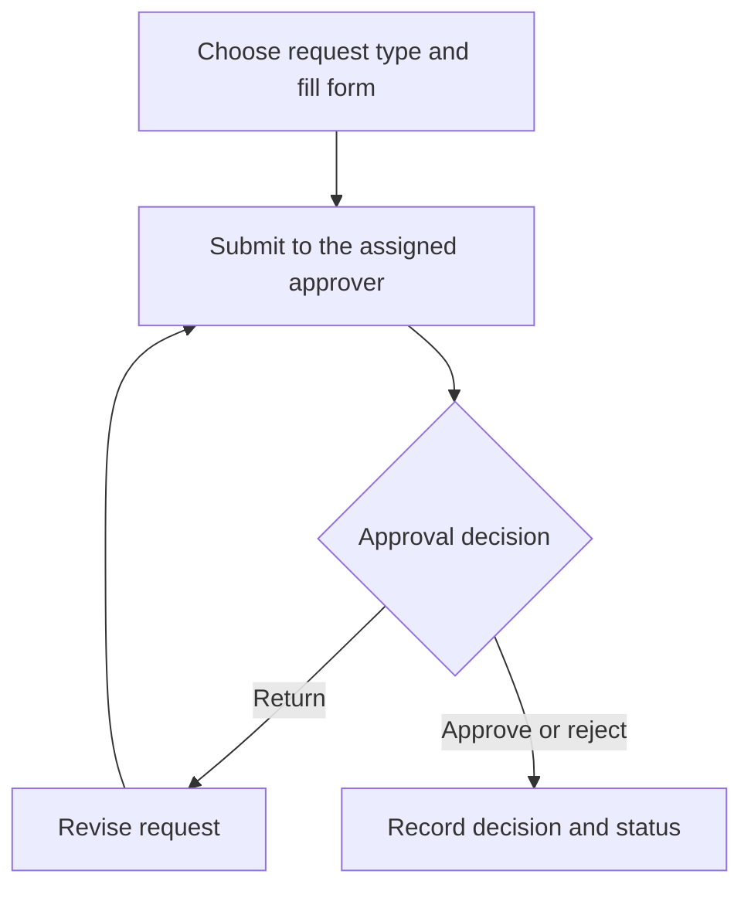

# Manufacturing request and approval design

[Portfolio](../README.md) · [中文](#中文)

**Requirements and workflow design** · Manufacturing operations · Microsoft Power Platform

## Business problem

Internal requests such as supplier onboarding, contract review and employee services used separate forms and approval procedures. Requesters and approvers needed a shared way to see who had the next action and what had already been decided.

## Workflow design

The requirements define a common intake and status model with separate views for requesters and approvers. The lifecycle covers draft, submission, return for revision, approval, rejection, recall and cancellation. Each request type retains its own form and routing rules. The proposed integration spans Outlook, SharePoint and Teams.

## Delivery and evidence

The source requirements library contains **21 workflow folders** covering areas such as purchasing, HR, logistics and employee services. The requirements pack defines requester and approver views and the request lifecycle. This design gives individual approval workflows a shared status vocabulary. Build completion and rollout are still unverified.

## 中文

### 制造企业内部申请与审批设计

**需求与流程设计阶段** · 制造运营 · Microsoft Power Platform

**业务问题与设计**  
供应商准入、合同审查及员工服务各有表单与审批规则。需求方案将提交人视图、审批人视图和状态管理统一起来，支持草稿、提交、退回、审批、拒绝、撤回与取消。各审批类型保留自己的字段和流转条件，方案规划对接 Outlook、SharePoint 和 Teams。

**交付证据**  
需求资料含 **21 个流程资料目录**，涉及采购、人力、物流和员工服务等场景。方案定义了申请生命周期和岗位视图，开发完成情况与上线范围待核实。

[返回中文目录](../README.zh-CN.md)
