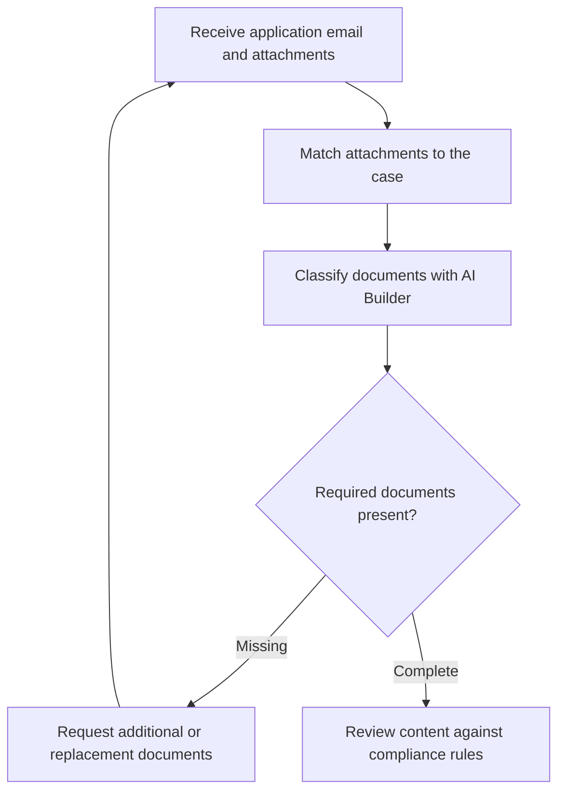

# AI-assisted real estate compliance intake

[Portfolio](../README.md) · [中文](#中文)

**Cloud flows built and documented** · Real estate operations · Power Automate, AI Builder

## Business problem

A real estate agency reviews customer-submitted identity documents, contracts, property evidence, income records and bank statements. Before reviewing the content, staff need to know which documents arrived and what the customer still needs to supply.

## Workflow design

A Power Automate cloud flow receives email from a Gmail inbox and groups attachments by case. AI Builder classifies the documents and checks the received categories against the applicable checklist. For incomplete cases, the workflow identifies missing items so the customer can be asked to resubmit or provide additional documents. For complete cases, it supports the team's review of document content against its rules, including authenticity checks.

## Delivery and evidence

The handover runbook documents **2 cloud flows** for intake and completeness checking, including **3 loan-type rules** that add supporting documents to the checklist. The wider compliance workflow also supports content review. Production volume, review accuracy and time savings are still unverified.

## 中文

### AI 辅助地产合规材料初审

**已构建云端流程及操作手册** · 地产运营 · Power Automate、AI Builder

**业务问题与实现**  
地产中介需要审核客户提交的身份文件、合同、地产证明、收入证明与银行流水。Power Automate 云端流程从 Gmail 接收邮件，将附件按案件归集，再由 AI Builder 分类并对照清单核查完整性。发现缺件时，流程提供补交或重提所需的信息。材料齐备后，流程协助团队按规则审核内容，包括真实性核查。

**交付证据**  
交接手册记录了收件和完整性检查的 **2 条云端流程**，以及 **3 条按贷款类别追加材料的规则**。实际处理量、核查准确率和审核耗时改善待核实。

[返回中文目录](../README.zh-CN.md)
