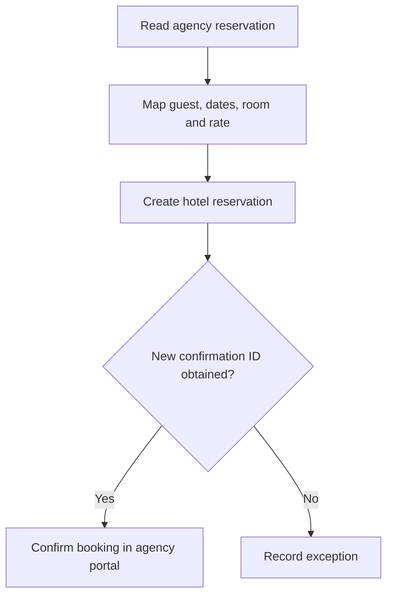

# Hotel reservation entry automation

[Portfolio](../README.md) · [中文](#中文)

**Automation built** · Hospitality operations · Power Automate for desktop, JavaScript

## Business problem

Reservations received through an online travel agency had to be entered in the hotel's property management system. The booking confirmation depended on getting the new reservation reference back into the agency portal.

## Workflow design

The desktop flow reads reservation details, maps guest names, stay dates, room codes and rates, then enters the reservation in the hotel's system. It waits for a newly generated reservation ID and checks that it differs from the previous booking ID. That check guards against confirming the current order with the preceding booking's reference. The flow records a skip reason when it cannot obtain a new ID.

## Delivery and evidence

The desktop flow automates the handoff between **2 web systems**. The project archive contains revised flow exports and a recorded demonstration. Production booking volume, exception rates and time savings are still unverified.

## 中文

### 酒店预订录入自动化

**已构建自动化流程** · 酒店运营 · Power Automate for desktop、JavaScript

**业务问题与实现**  
在线旅行平台的订单需要录入酒店预订系统，再将新生成的预订编号回填以确认订单。桌面流程提取订单明细，转换旅客姓名、入住日期、房型和房价字段，在酒店系统创建预订。回填前确认编号已更新，避免沿用上一笔订单的编号。获取失败时记录异常原因。

**交付证据**  
桌面流程串联 **2 套 Web 系统**。项目资料含多个流程版本和操作录屏。实际订单量、异常率和录入耗时改善待核实。

[返回中文目录](../README.zh-CN.md)
