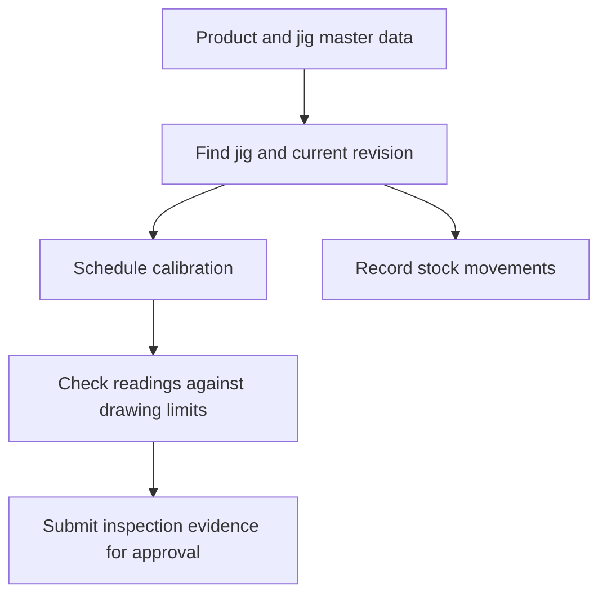

# Manufacturing jig management

[Portfolio](../README.md) · [中文](#中文)

**App packaged** · Manufacturing quality · Power Apps, SharePoint

## Business problem

Production and quality teams needed to find tooling by finished product, track jig stock and make calibration decisions against the correct specifications.

## Workflow design

The design links product and jig master data, then uses revision status to keep current specifications identifiable. Calibration due dates use the last calibration date and the specified interval. The planned inspection workflow compares readings against drawing limits, captures photos as supporting evidence and records the approval. The inventory workflow records issues, returns and stock balances.

## Delivery and evidence

The archive contains a data model, a UI design and versioned exports of a SharePoint-connected Canvas app. The updated package declares **11 data source references**. The workflow diagram reflects the design scope. Feature acceptance and production usage are still unverified.

## 中文

### 制造工装夹具管理

**已有应用交付包** · 制造质量 · Power Apps、SharePoint

**业务问题与设计**  
生产和质量人员需要按成品型号找夹具，查看库存，并按有效版本的图纸要求执行校验。方案按上次校验时间与周期计算下次校验日期，计划由系统记录实测值、判定是否超差、留存照片并提交审批。库存流程登记出入库和结余，版本管理提供有效规格的查询依据。

**交付证据**  
资料含数据表结构、界面草图和多个版本的 SharePoint 画布应用导出包。更新包声明了 **11 个数据源引用**。流程图依据设计范围绘制，功能验收与实际使用情况待核实。

[返回中文目录](../README.zh-CN.md)
