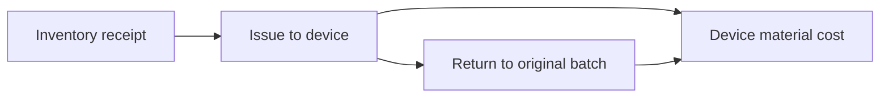

# Manufacturing operations and MRP

[Portfolio](../README.md) · [中文](#中文)

**Deployed** · Manufacturing systems

## Business context

Manufacturing teams needed purchasing, warehouse movements, device handoff and finance to agree on the same operational records.

## My contribution

Implemented and released workflow changes in an Express and MySQL application. Added role checks, version checks, and all-or-nothing rejection of unauthorized inventory changes. Traced device material costs to actual inventory movements and original issue batches for returns.

## Delivery and results

Release records document 79 passing automated checks for the second finance release and post-deploy health and access checks. Cost and return scenarios were exercised with isolated test data.

## 中文

### 制造运营与 MRP

**已上线**

**业务背景**

制造团队需要让采购、仓库出入库、设备交接和财务使用一致的业务记录。

**我的贡献**

基于 Express 和 MySQL 实现并发布业务流程改动，加入角色权限、版本检查和越权库存变更整批拒绝。设备材料成本追溯到实际出入库，退料按原出库批次冲回。

**交付与结果**

第二轮财务版本的发布记录显示 79 项自动化检查通过，上线后核验了服务健康和访问控制。成本和退料场景用隔离测试数据进行了验证。

[返回中文目录](../README.zh-CN.md)
