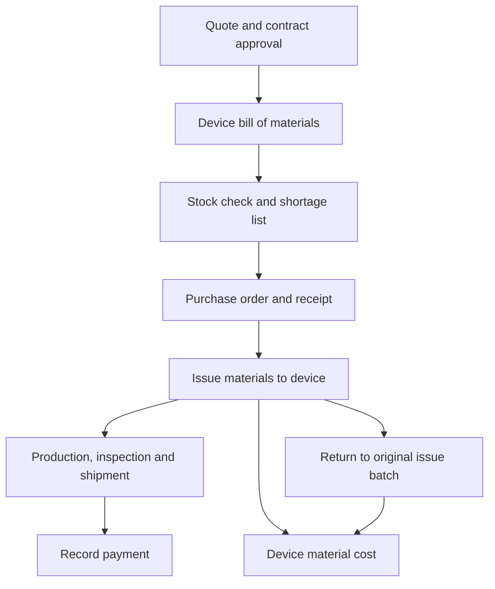

# Manufacturing operations and MRP

[Portfolio](../README.md) · [中文](#中文)

**Cloud pilot and follow-up releases** · Manufacturing systems · Express, MySQL

## Business problem

Sales, engineering, purchasing, warehouse and finance needed to trace a machine from quotation through shipment and payment. Finance also needed to explain its material cost using the inventory movements behind it.

## My contribution

I implemented and released warehouse and finance workflow changes in the Express and MySQL application. The system checks the user's role and record version before applying inventory edits, and rejects the entire change if any part is unauthorized. Issued materials roll up to the machine's actual cost. Returns reverse the cost of the original issue batch so finance can reconcile the adjustment to its source.

## Delivery and evidence

| Measure | Evidence |
| --- | --- |
| **9 modules, 26 pages, 14 role types** | Scope of the August 2026 cloud pilot. The pilot report describes sample data and a planned migration to live business data. |
| **14 supported quotation currencies** | Pilot scope for domestic and export sales. |
| **79 passing automated checks** | Second finance release record. Post-deployment checks covered service health and access controls. Cost and return scenarios were exercised with isolated test data. |

The cost trail gives warehouse and finance a common record for investigating stock movements, returns and cost adjustments. Live transaction volume and reconciliation time savings are still unverified.

## 中文

### 制造运营与 MRP

**云端试运行及后续版本发布** · 制造运营 · Express、MySQL

**业务问题**  
销售、设计、采购、仓库与财务需要共同追踪设备从报价到发货、收款的过程，财务还需要能把设备材料成本追溯到具体的库存变动。

**我的贡献**  
我在 Express 和 MySQL 应用中实现并发布仓库及财务流程改动。写入前检查岗位权限与记录版本，任何一项库存变更越权时整批拒绝。设备材料成本按实际领料核算，退料冲回原领料批次的成本，财务可据此核对差异。

**交付证据**  
2026 年 8 月云端试运行覆盖 **9 个模块、26 个页面、14 类岗位角色**，内销与外销报价支持 **14 种币种**。当时使用演示数据，正式业务数据待迁移。第二轮财务版本的发布记录显示 **79 项自动化检查通过**，上线后核验了服务健康和访问权限，并用隔离测试数据验证成本与退料场景。实际交易量和对账耗时改善待核实。

[返回中文目录](../README.zh-CN.md)
