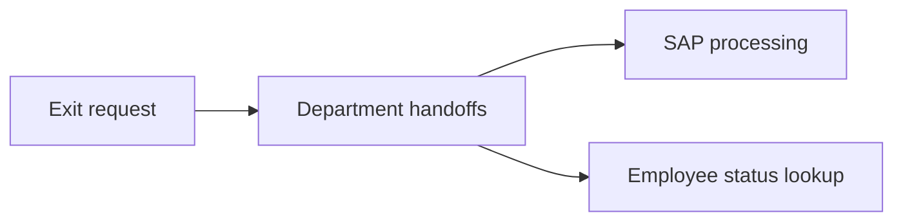

# Employee offboarding automation

[Portfolio](../README.md) · [中文](#中文)

**Delivered** · Automation

## Business context

Paper handoffs and status calls slowed an employee exit process spanning IT, HR and other departments.

## My contribution

Redesigned equipment returns from six steps to three. Built status self-service and connected the workflow across 11 departments and 14 SAP interfaces using Power Automate, UiPath and desktop automation.

## Delivery and results

Project records estimate workload savings equivalent to about three full-time roles.

## 中文

### 员工离职流程自动化

**已交付**

**业务背景**

员工离职涉及 IT、人力资源等多个部门，纸质交接和人工状态查询拖慢了流程。

**我的贡献**

将设备归还从六步简化为三步，搭建自助进度查询，并用 Power Automate、UiPath 和桌面自动化连接 11 个部门和 14 个 SAP 接口。

**交付与结果**

项目记录估算节省的工作量约相当于 3 个全职岗位。

[返回中文目录](../README.zh-CN.md)
