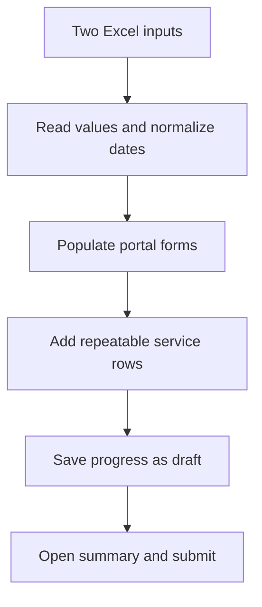

# Port call reporting automation

[Portfolio](../README.md) · [中文](#中文)

**Automation built** · Ocean shipping operations · Power Automate Desktop, Excel

## Business problem

Port operations staff receive shipping documents and enter vessel and voyage information into the carrier's internal reporting portal. The inputs and portal fields follow different layouts, so operators have to translate and enter the data in sequence. A single report spans several forms, including repeatable rows for services such as pilotage and towage.

## Workflow design

The desktop flow reads structured source values, normalizes date and time fields, and maps the data to the portal's form controls. It adds rows for service records, saves drafts at intermediate steps and opens the summary before sending the report. The mapping and date conversions are kept in separate routines so changes to field formatting can be traced to one place.

## Delivery and evidence

The workflow covered **roughly a dozen sequential entry screens**, based on the project walkthrough. The archived flow version shows **8 named reporting sections** across arrival, departure, vessel services and operations. The project archive also includes screen recordings. The automation standardizes how source fields reach the portal and removes repeated entry from the designed workflow. Production run volume, exception rates and time savings are still unverified.

## 中文

### 船舶靠港申报自动化

**已构建自动化流程** · 国际航运运营 · Power Automate Desktop、Excel

**业务问题与实现**  
运营人员收到船运文件后，需要把船舶与航次信息按顺序录入承运商的内部申报系统。引航和拖轮等服务还可能涉及多行。桌面流程从两份 Excel 读取结构化字段，转换日期和时间格式，映射到门户表单，按需要增加服务明细行，并分阶段保存草稿，最后进入汇总页提交。取值与日期转换拆为独立例程，便于定位格式规则。

**交付证据**  
据项目说明，完整流程涉及 **约十几个按顺序录入的页面**。存档版本可识别 **8 个具名申报区块**，涉及到港、离港、船舶服务与港口作业。资料另有操作录屏。实际运行量、异常率与单次申报节省时长待核实。

[返回中文目录](../README.zh-CN.md)
