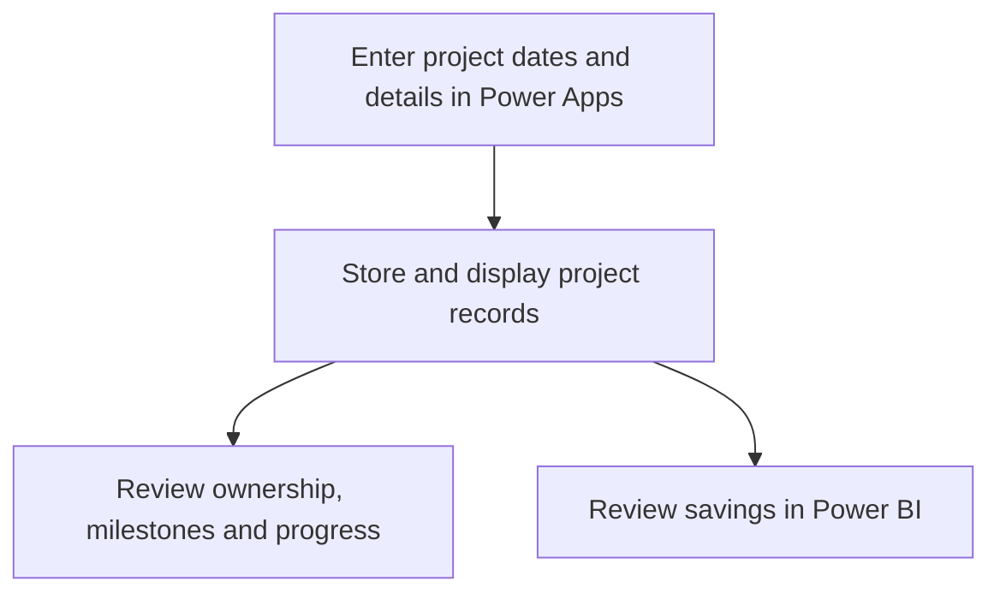

# Procurement project management and analytics

[Portfolio](../README.md) · [中文](#中文)

**App and dashboard built** · Procurement operations · Power Apps, SharePoint, Power BI, Excel

## Business problem

Procurement teams needed one way to enter and display project dates, track milestones and analyze progress and savings. The process used annual master workbooks, which combined investment categories, milestones, business units and finance references.

## Solution

The Power Apps tracker provides an interface for initiative records backed by SharePoint, with Power BI dashboards for project and savings review. FY26 requirements called for partial search by initiative description, clearer progress text and a dedicated savings view. Those requirements addressed two tasks for reviewers, finding the right initiative and following its financial status across reporting cycles.

## Delivery and evidence

The project archive contains Power Apps exports and Power BI dashboard files for FY25 and FY26. One tracker export contains **333 data rows**, counted by excluding the header and blank rows. The row count documents the scale of that snapshot. Realized savings attributable to the solution, adoption and reporting time savings are still unverified.

## 中文

### 采购项目管理与分析

**已构建应用和报表** · 采购运营 · Power Apps、SharePoint、Power BI、Excel

**业务问题与实现**  
采购团队需要录入和展示项目时间、跟踪项目节点与进度，并分析项目及节省额。年度主表汇集支出类别、完成时间、业务单元和财务参考编号。Power Apps 提供基于 SharePoint 的项目追踪界面，Power BI 支持项目及节省额复盘。FY26 需求明确了按项目描述模糊搜索、改善进度显示、增加节省额专页，便于评审时找到项目并跟进其财务状态。

**交付证据**  
项目资料含 FY25 和 FY26 的应用导出包与 Power BI 报表文件。一份追踪器导出包含 **333 条数据记录**，统计时剔除了表头与空行。使用覆盖率、报表耗时改善以及可归因于系统的收益待核实。

[返回中文目录](../README.zh-CN.md)
