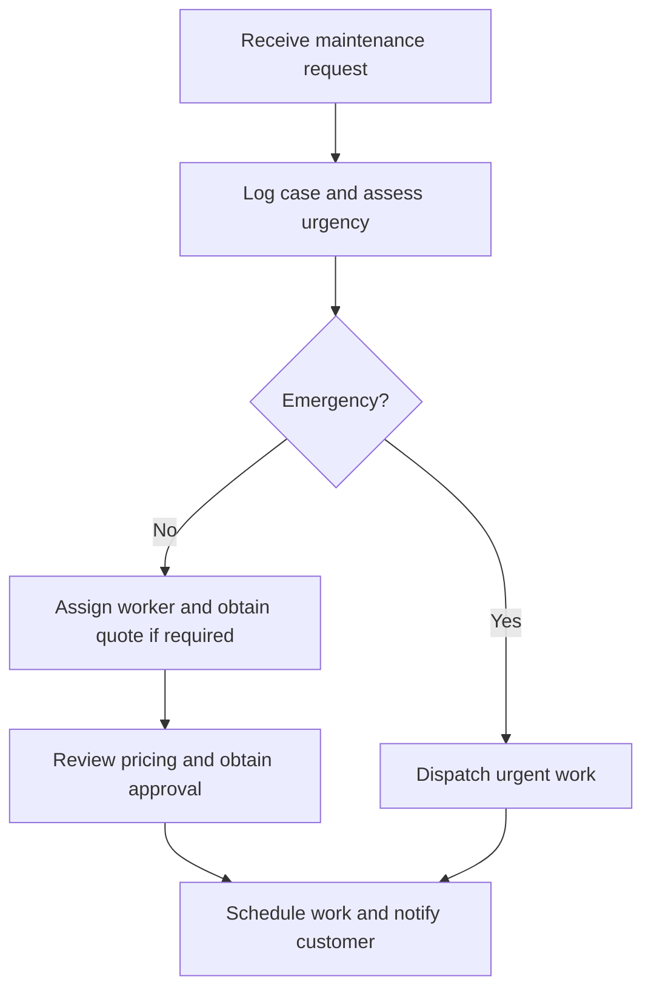

# Rental maintenance request workflow

[Portfolio](../README.md) · [中文](#中文)

**Workflow design documented** · Property management · Power Automate

## Business problem

A rental property team needed to turn tenant emails into trackable jobs. Staff had to assess the issue, assign it to the right person, coordinate contractor quotes and keep customers informed.

## Workflow design

The workflow records each case, determines urgency and responsibility, and routes it to the appropriate worker. When a quote is required, the assignee coordinates pricing and obtains the applicable approval before dispatch. Notifications keep the customer informed. An emergency path allows immediate dispatch for urgent safety issues.

## Delivery and evidence

The workflow specification covers intake, assignment, pricing, approval and notifications. It defines standard and emergency paths and records the decision points that determine the next handoff. Implementation coverage, production usage and turnaround time are still unverified.

## 中文

### 出租物业维修工单流程

**已有流程设计文档** · 物业管理 · Power Automate

**业务问题与设计**  
出租物业团队需要将客户邮件转成可跟进的维修工单。方案记录工单，判断紧急程度与责任，再分配给相应人员。需要报价时，对接承包商询价、确认报价和审批，随后安排维修并通知客户。紧急安全事件可直接派工。

**交付证据**  
流程文档包含收件、分单、询价、报价审批和客户通知，并定义常规与紧急两条路径。实施范围、实际工单量与响应时效待核实。

[返回中文目录](../README.zh-CN.md)
