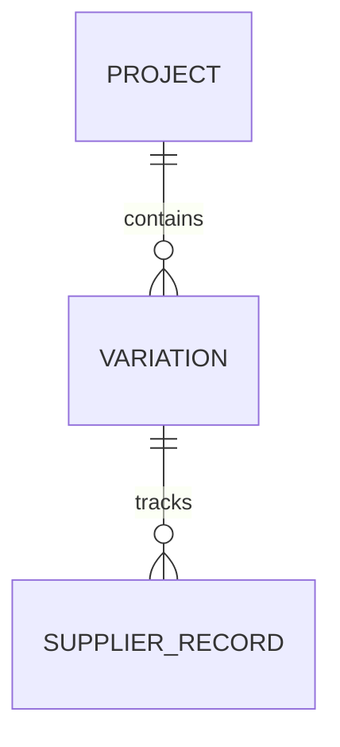

# Construction variation management

[Portfolio](../README.md) · [中文](#中文)

**Requirements & design** · Business applications

## Business context

Commercial teams needed to link client instructions to supplier quotations, approvals and final orders.

## My contribution

Defined the Power Apps and SharePoint MVP around projects, client variations and linked subcontractor quotation and order records. Captured the two-stage approval requirement.

## Delivery and results

Produced a requirements and data-model baseline for stakeholder validation.

## 中文

### 工程变更与分包询价管理

**需求与设计阶段**

**业务背景**

商务团队需要把客户变更指令、分包询价、审批及最终订单串起来。

**我的贡献**

围绕项目、客户变更以及关联的分包询价和订单记录，梳理 Power Apps 和 SharePoint MVP，并记录两级审批需求。

**交付与结果**

形成了供业务方确认的需求及数据模型。

[返回中文目录](../README.zh-CN.md)
